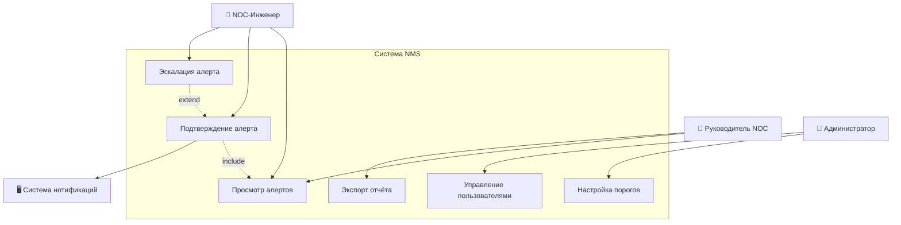

# Диаграмма Use Case для NMS

Пример из `wiegers_sa_reference.md`, § 11.1, Mermaid-диаграмма (строки 1516–1540).

## Проверка по примеру

- Внешние акторы расположены снаружи границы NMS. Связи с вариантами показывают участников каждой цели.
- Сверь обязательность включения просмотра при подтверждении и условие добавления эскалации. Диаграмма и текст UC-004 из § 7.1 задают разные связи. Если они используются как описание одной системы, согласуй применимые отношения.
